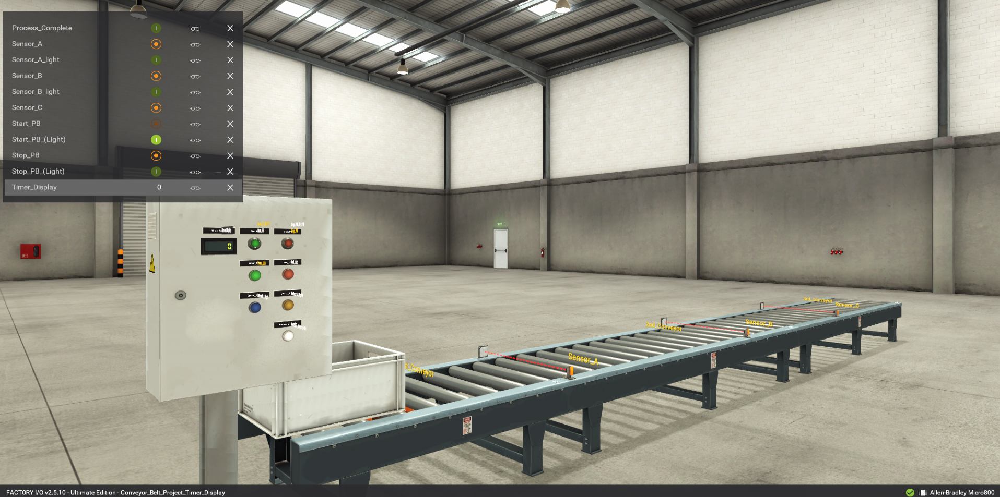
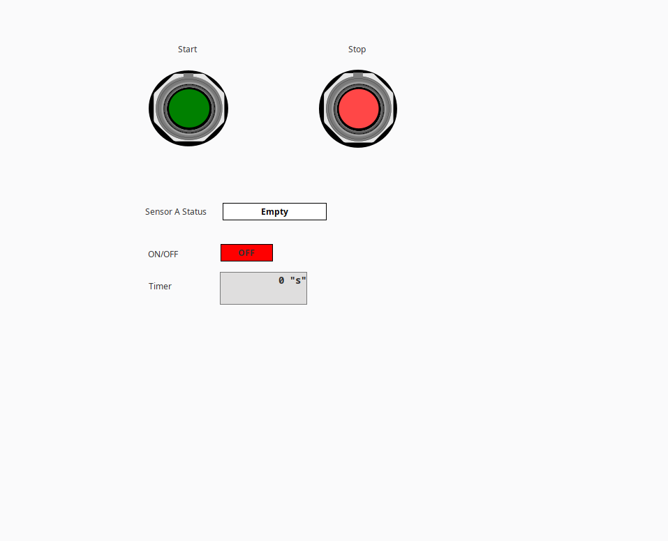
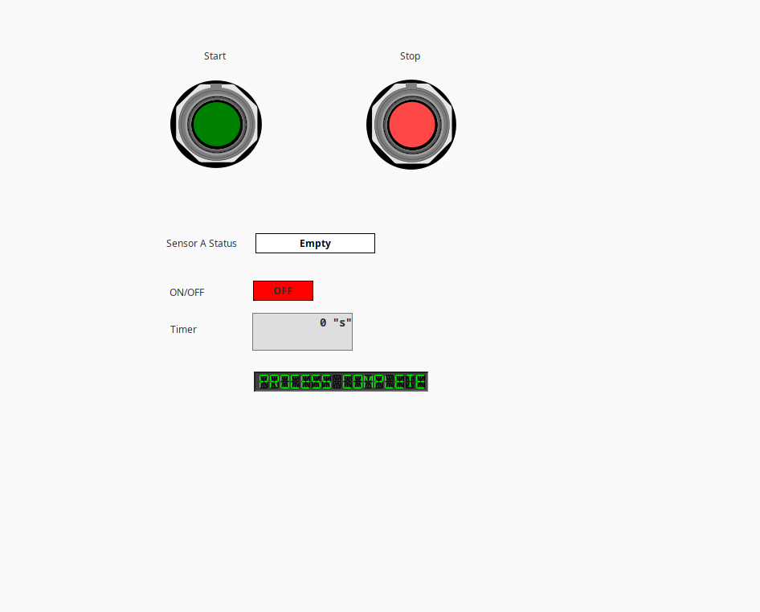

# PLC Conveyor Belt Control & Timer Display System

An integrated industrial automation cell combining virtual plant commissioning, Allen-Bradley Micro850 PLC ladder logic, and an Ignition Vision HMI. The system tracks item progression along a conveyor line, times processing cycles, and provides real-time operator control and live status feedback.

---

## System Architecture

* **PLC Logic:** Rockwell Connected Components Workbench (CCW) controlling an Allen-Bradley Micro850 simulator.
* **Physics & Plant Simulation:** Factory I/O (3D virtual commissioning conveyor scene).
* **Operator Interface (HMI):** Inductive Automation Ignition Vision.
* **Industrial Communication:** Direct OPC-UA via Ignition Micro800 Driver over loopback (`127.0.0.1`).

---

## 3D Plant Simulation

The mechanical conveyor cell is modeled in Factory I/O. It utilizes discrete digital inputs and outputs mapped to controller registers to coordinate mechanical belt movement, photo-eye part detection, and system timing.

---

## HMI Interface (Ignition Vision)

The HMI application communicates directly with the Micro850 memory tags to display process timing, live optical sensor states, and cycle status.

### Standby / Item Detected
Displays conveyor run state, motor feedback, and real-time timer accumulation when an incoming item trips the detection photo-eye.

### Process Complete
An inverted boolean expression (`!BOOL_IN_5`) monitors the normally closed (NC) terminal exit sensor (Sensor C) to illuminate the multi-segment LED display upon successful cycle completion.

---

## I/O & Tag Addressing Table

| Tag Name | Data Type | Factory I/O Tag / Device | Field Type | Function / Logic Description |
| :--- | :--- | :--- | :--- | :--- |
| `BOOL_IN_0` | BOOL | Sensor_A | Discrete Input (NC Photo-eye) | Entry part detection / triggers cycle initiation |
| `BOOL_IN_1` | BOOL | Sensor_B | Discrete Input (NC Photo-eye) | Intermediate tracking / position handshake |
| `BOOL_IN_2` | BOOL | *(Reserved)* | Discrete Input | Unassigned input channel on PLC |
| `BOOL_IN_3` | BOOL | Start_PB | Discrete Input (NO Pushbutton) | Operator start command to energize conveyors |
| `BOOL_IN_4` | BOOL | Stop_PB | Discrete Input (NC Pushbutton) | Operator stop command / cycle interruption |
| `BOOL_IN_5` | BOOL | Sensor_C | Discrete Input (NC Photo-eye) | End-of-line exit detection; inverted in HMI to trip completion |
| `BOOL_OUT_0` | BOOL | 1st_Conveyor | Discrete Output (Actuator) | Drives 1st conveyor section |
| `BOOL_OUT_1` | BOOL | 2nd_Conveyor | Discrete Output (Actuator) | Drives 2nd conveyor section |
| `BOOL_OUT_2` | BOOL | Start_PB_(Light) | Discrete Output (Indicator) | Illuminates Start pushbutton bezel during active state |
| `BOOL_OUT_3` | BOOL | Stop_PB_(Light) | Discrete Output (Indicator) | Illuminates Stop pushbutton bezel |
| `BOOL_OUT_4` | BOOL | Green_LED | Discrete Output (Indicator) | Panel run / healthy status indicator |
| `BOOL_OUT_5` | BOOL | Red_LED | Discrete Output (Indicator) | Panel stopped / fault status indicator |
| `BOOL_OUT_6` | BOOL | Sensor_A_light | Discrete Output (Indicator) | Physical station indicator light for Sensor A status |
| `BOOL_OUT_7` | BOOL | Sensor_B_light | Discrete Output (Indicator) | Physical station indicator light for Sensor B status |
| `BOOL_OUT_8` | BOOL | 3rd_conveyor | Discrete Output (Actuator) | Drives 3rd conveyor section |
| `BOOL_OUT_9` | BOOL | Process_Complete | Discrete Output (Indicator) | Physical completion status |
| `INT_OUT_0` | INT | Timer_Display | Analog / Word Output | Passes timer accumulator integer to physical/simulated display |
---

## Project Repository Files

* `Conveyor_Belt_Project_Timer_Display.ccwsln`: Connected Components Workbench PLC solution file.
* `Conveyor_Belt_Project_Timer_Display.factoryio`: Factory I/O virtual commissioning scene.
* `Conveyor_Belt_Project_Timer_Display_HMI.zip`: Ignition HMI.
* `/Controller`: Controller program files and rung exports.
